<div align="center">

# JSON Studio: Visual JSON Builder

Build any JSON structure by dragging typed blocks. Edit keys and values inline, preview with syntax highlighting, import or export instantly. No install, no build step.

[![Live][badge-site]][url-site]
[![HTML5][badge-html]][url-html]
[![CSS3][badge-css]][url-css]
[![JavaScript][badge-js]][url-js]
[![Claude Code][badge-claude]][url-claude]
[![License][badge-license]](LICENSE)

[badge-site]:    https://img.shields.io/badge/live_site-0063e5?style=for-the-badge&logo=googlechrome&logoColor=white
[badge-html]:    https://img.shields.io/badge/HTML5-E34F26?style=for-the-badge&logo=html5&logoColor=white
[badge-css]:     https://img.shields.io/badge/CSS3-1572B6?style=for-the-badge&logo=css3&logoColor=white
[badge-js]:      https://img.shields.io/badge/JavaScript-F7DF1E?style=for-the-badge&logo=javascript&logoColor=black
[badge-claude]:  https://img.shields.io/badge/Claude_Code-CC785C?style=for-the-badge&logo=anthropic&logoColor=white
[badge-license]: https://img.shields.io/badge/license-MIT-404040?style=for-the-badge

[url-site]:   https://jsonstudio.neorgon.com/
[url-html]:   #
[url-css]:    #
[url-js]:     #
[url-claude]: https://claude.ai/code

</div>

---

A drag-and-drop JSON editor for building any JSON structure visually. No install, no build step.

## Features

- **Block palette**: drag Object, Array, String, Number, Boolean, or Null blocks onto the canvas
- **Inline editing**: rename keys and edit values directly in the tree
- **Type color system**: blue = object, purple = array, green = string, amber = number, pink = boolean
- **Nested trees**: collapse/expand subtrees, drag to reorder, depth indicated by left-border color
- **Live preview**: syntax-highlighted JSON output in the right panel
- **Edit mode**: paste raw JSON directly; parse errors shown inline
- **Import / Download**: load any `.json` file or save the result
- **Open in Visualizer**: send current JSON to the [JSON Visualizer](visualizer/) to explore, filter, and pivot
- **Embed anywhere**: put the Visualizer's table in your own page with an iframe. The data goes in by `postMessage`, never in a URL, and the embed page requests nothing but its own files. Configure it at [visualizer/embed-builder.html](visualizer/embed-builder.html)
- **Templates**: start from empty object/array, array of objects, or grouped (pivot-friendly) shape
- **Keyboard**: Delete node, Expand/Collapse all (Ctrl+Shift+E / C), Copy node as JSON (Ctrl+Shift+J)

For JSON shapes that work best with the Visualizer (flat list, grouped, pivot), see [docs/patterns.md](docs/patterns.md).

## Running

Open `index.html` directly in a browser. No dependencies, no server required.

```bash
make serve          # http://localhost:8802
make test           # Node: the embed URL contract and page parity
make test-browser   # serves the site; open /tests/browser.html for the embed contract
```

## Architecture



Three tools, no build step, no dependencies:

- **Builder** (`index.html`, `js/`, `css/style.css`): ES modules. `state.js` holds `root`, `nodeMap`, `idCounter`, `drag` and `editMode`; `render.js` rebuilds `#tree-root` from scratch on every change and refreshes the JSON panel; `events.js` wires the palette, drag-and-drop, templates, import and export; `utils.js` converts between the node tree and JSON.
- **Visualizer** (`visualizer/`): ES modules, one per concern: `load.js`, `table.js`, `filter.js`, `pivot.js`, `tree.js`, `modal.js`, `stats.js`, `export.js`. `embed.html` is the same viewer with no header and no input screen, driven by `postMessage`; see [visualizer/README.md](visualizer/README.md#embedding).
- **Scrambler** (`scrambler/index.html`): single file.

State lives in memory. The Visualizer keeps a session copy in `sessionStorage` so a refresh keeps the data; the embed never does.

## Live

→ [jsonstudio.neorgon.com](https://jsonstudio.neorgon.com/)

---

<div align="center">
  <sub>Part of <a href="https://neorgon.com">Neorgon</a></sub>
</div>
